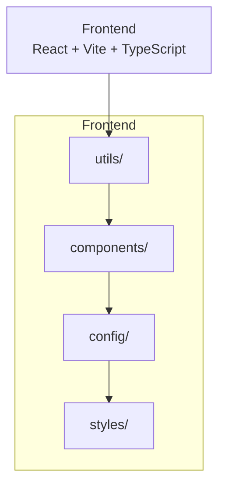

# PaintNum


**PaintNum turns your photos into printable paint-by-numbers paintings.**

The app promotes creativity and sustainability, allowing users to turn personal photos into paint-by-number sheets they can print and paint.

&nbsp;&nbsp;&nbsp;&nbsp;


&nbsp;&nbsp;&nbsp;&nbsp;

&nbsp;&nbsp;&nbsp;&nbsp;
[](https://pwabuilder.com/reportcard?site=https://ismaelmarot.github.io/PaintNum/)

### Frontend Stack


&nbsp;&nbsp;&nbsp;&nbsp;

<br>

<p align="center">
  <a href="https://ismaelmarot.github.io/PaintNum/" target="_blank">
    
  </a>
</p>

<br>

---

## What It Does?

- **Turn photos into paint-by-numbers**: Users upload a photo and the app generates a printable paint-by-numbers painting.
- **Compare original vs painting**: Visual comparison with the original photo and the generated painting.
- **Color configuration**: Adjust palette size, region size, and detail level.
- **Export**: Export the painting as PDF or ZIP (with color table).
- **Share**: Share the painting via native share or social intents.

&nbsp;&nbsp;&nbsp;&nbsp;

---

## 🛠️ INFRASTRUCTURE & SERVICES

| Service | Badge | Description |
|---------|-------|-------------|
| **Frontend Deployment** |  | Hosting estático del frontend React con CDN global y SSL automático |

&nbsp;&nbsp;&nbsp;&nbsp;

---

## 📊 PWA SCORECARD

> PaintNum is a frontend-only Progressive Web App. The badge shows the live score from PWABuilder, updated automatically.

| Categoria | Estado | Detalle |
|-----------|--------|---------|
| 🌐 **Manifest** | ✅ | name, description, icons (192+512), start_url, display, background/theme color |
| ⚡ **Service Worker** | ❌ | Not implemented (frontend-only, no Workbox) |
| 🔒 **HTTPS** | ✅ | SSL automatic via GitHub Pages CDN global |
| 📱 **Instalable** | ✅ | Meets installability criteria (manifest + HTTPS) |
| 🖼️ **App Capabilities** | ❌ | Shortcuts, Share Target, etc. not implemented |

<br>

[](https://pwabuilder.com/reportcard?site=https://ismaelmarot.github.io/PaintNum/)

&nbsp;&nbsp;&nbsp;&nbsp;

---

## 📑 TABLE OF CONTENT

1. [PWA Scorecard](#pwa-scorecard)
2. [Highlights](#highlights)
3. [Core Features](#core-features)
4. [Technologies Stack](#technologies-stack)
5. [Codebase Layer Map](#codebase-layer-map)
6. [Installation](#installation)
7. [Usage](#usage)
8. [Project Structure](#project-structure)
9. [Live Demo](#live-demo)
10. [Versions](#versions)

&nbsp;&nbsp;&nbsp;&nbsp;

---

## 🌟 HIGHLIGHTS

- Frontend-only application with React 19 + TypeScript + Vite.
- All paint generation processing runs in the browser.
- Responsive, Apple-inspired visual design.
- Styled-components for CSS-in-JS.
- Fully typed with TypeScript.
- CI/CD deployment with GitHub Pages.

&nbsp;&nbsp;&nbsp;&nbsp;

---

## ✨ CORE FEATURES

| Feature             | Description                                                      |
| ------------------- | ---------------------------------------------------------------- |
| Turn photos into paint-by-numbers | Upload a photo and generate a printable paint-by-numbers painting |
| Compare             | Visual comparison between original and generated painting       |
| Color configuration | Adjust palette size, region size, and detail level              |
| Export              | Export the painting as PDF or ZIP (with color table)            |
| Share               | Share via native share or social intents                        |

&nbsp;&nbsp;&nbsp;&nbsp;

---

## 🛠️ TECHNOLOGIES STACK

| Category            | Library / Tool     | Version |
|---------------------|--------------------|---------|
| Frontend UI         | React              | ^19.1.0 |
| Frontend Language   | TypeScript         | ~5.8.0  |
| Frontend Build      | Vite               | ^7.1.5  |
| Frontend Styling    | styled-components  | ^6.1.19 |

&nbsp;&nbsp;&nbsp;&nbsp;

---

## 🔄 CODEBASE LAYER MAP



&nbsp;&nbsp;&nbsp;&nbsp;

---

## 🚀 INSTALLATION

### Prerequisites

- Node.js >= 18
- npm

### 1. Clone the repository

```bash
git clone https://github.com/ismaelmarot/PaintNum.git
cd PaintNum
```

### 2. Install dependencies

```bash
npm install
```

### 3. Run development server

```bash
npm run dev
```

### 4. Access the app

- Frontend: http://localhost:5173

&nbsp;&nbsp;&nbsp;&nbsp;

---

## ⚙️ USAGE

| Step | Description                                            |
| ---- | ------------------------------------------------------ |
| 1    | Upload a photo                                        |
| 2    | Generate the paint-by-numbers painting                |
| 3    | Compare original vs painting                         |
| 4    | Adjust colors / detail                                |
| 5    | Export (PDF / ZIP) or Share                           |

&nbsp;&nbsp;&nbsp;&nbsp;

---

## 📂 PROJECT STRUCTURE

```
PaintNum
├── src/
│   ├── components/       # Reusable UI components
│   ├── config/           # Processing limits / presets
│   ├── styles/           # Theme, base styles, app styles
│   ├── utils/            # imageProcessing, exporting
│   └── interfaces/       # Shared TS types
├── public/
│   └── icons/            # App icons (favicon, manifest, apple-touch)
├── docs/
│   └── sdd/              # Software design docs
├── index.html
├── vite.config.ts
└── package.json
```

&nbsp;&nbsp;&nbsp;&nbsp;

---

## 🌍 LIVE DEMO

| Service | URL | Status |
|---------|-----|--------|
| 🌐 **Frontend (GitHub Pages)** | [https://ismaelmarot.github.io/PaintNum](https://ismaelmarot.github.io/PaintNum/) |  |

&nbsp;&nbsp;&nbsp;&nbsp;

---

## 📌 VERSIONS

| Version | Date       | Changes                                                                                                         |
|---------|------------|-----------------------------------------------------------------------------------------------------------------|
| 1.0.0   | 30/10/2026 | Initial release - Paint-by-numbers generation, comparison, export and sharing.                                 |

&nbsp;&nbsp;&nbsp;&nbsp;

---

## 🔒 SECURITY

- **Environment Variables**: Not applicable (frontend-only, no backend secrets).
- **No Hardcoded Secrets**: The codebase contains no hardcoded credentials.
- **Password Hashing**: Not applicable (no auth backend).
- **JWT Authentication**: Not applicable (no auth backend).

### For Production Deployment

1. Use HTTPS for all communications (GitHub Pages provides SSL automatically).

&nbsp;&nbsp;&nbsp;&nbsp;

---

## 📄 LICENSE

This project is licensed under the MIT License - see the [LICENSE](/PaintNum/blob/HEAD/LICENSE) file for details.

## 📬 CONTACT

Open to collaboration, feedback, and new opportunities.

[](https://github.com/ismaelmarot)
[](https://linkedin.com/in/ismael-marot-1aab33440)
[](https://ismaelmarot.github.io)
